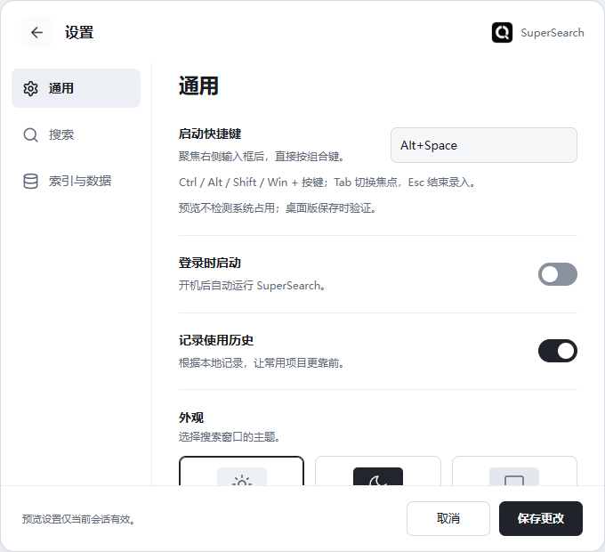

# SuperSearch

**English** | [简体中文](README.zh-CN.md)

A Windows app launcher and file-name search tool, built with Tauri 2, Rust, Svelte 5 and the Everything SDK. Find apps, files and folders with name, pinyin, initials and alias matching from a keyboard-driven search bar.

**[Download v0.1.7](https://github.com/Onlyaiyancc/SuperSearch/releases/tag/v0.1.7)** · [All releases](https://github.com/Onlyaiyancc/SuperSearch/releases) · [Report a bug](https://github.com/Onlyaiyancc/SuperSearch/issues/new?template=bug.yml)

Windows x64 only. The application interface is currently Simplified Chinese. Release binaries are **unsigned** and require Microsoft WebView2 Runtime.


## Features

- Search installed apps, files and folders by name; use pinyin, initials and aliases for app matching.
- Open the search bar with a configurable global shortcut and navigate results with the keyboard.
- Prioritize matching items you have opened before; pin items and configure search locations.
- Use a dedicated Everything service for fast NTFS indexing, with directory scanning when the service is unavailable or the file system is unsupported.
- Choose light, dark or system appearance, and recall the window at its remembered position or centered on the monitor containing the pointer.
- Search the web explicitly, or use Bing as a fallback when a completed local search has no matches.

## Download and install

Choose an asset from the [latest stable release](https://github.com/Onlyaiyancc/SuperSearch/releases/latest):

| Asset | Use |
| --- | --- |
| `SuperSearch_0.1.7_x64-setup.exe` | Recommended for the complete installation and dedicated indexing service. Requires administrator permission. |
| `SuperSearch-portable-x64.zip` | Extract the complete archive and run `SuperSearch.exe`. Keep all bundled license files. WebView2 must already be installed. |
| `SHA256SUMS.txt` | SHA-256 checksums for the release attachments. |
| `Release-Acceptance.md` | Validation evidence and remaining limitations for this build. |

Before upgrading, exit the old instance from the system tray. The installer registers `Everything (SuperSearch)` separately from a personal Everything installation. If WebView2 is missing, it downloads the runtime; restore network access and retry if the download fails. Portable mode uses directory scanning when the dedicated service is unavailable. Initial indexing can take several minutes; the advanced settings panel refreshes the loading state automatically.

The app and installer are unsigned, so Windows may display an unknown-publisher or SmartScreen prompt. Download from this repository's Releases page and compare the downloaded file with `SHA256SUMS.txt`:

```powershell
Get-FileHash .\SuperSearch_0.1.7_x64-setup.exe -Algorithm SHA256
```

## Quick start

| Shortcut | Action |
| --- | --- |
| `Alt+Space` | Show or hide the search bar; configurable in settings. |
| `↑` / `↓` | Select a result. |
| `Enter` | Open the selected result, or search Bing after a completed local search returns no matches. |
| `Ctrl+Enter` | Reveal the selected local item in File Explorer. |
| `Shift+Enter` | Search the current query on Bing. |
| `Tab` | Cycle available path completions. |
| `Ctrl+,` | Open settings. |
| `Esc` | Close the current panel or hide the search bar. |

In **Settings → General**, change the shortcut, theme and display positioning. The positioning choices are “记住上次位置” (remember the last position) and “跟随鼠标所在显示器” (follow the pointer's monitor). Use a result's action menu to pin it or edit an application's aliases; configure search locations under **Settings → Search**.



## Privacy and validation

Normal operation sends no telemetry by default. Settings and usage history stay on the local machine; history can be disabled or cleared in settings. An explicit web search passes the query to the default browser and Bing.

The exact v0.1.7 installer passed upgrade, retained-data, service-query, uninstall/coexistence and fresh-install checks on a disposable Windows runner. Missing-WebView2 testing verified failed-download cleanup and successful online recovery on Windows Server 2025. The exact portable executable passed a short native UI/resource diagnostic.

The maintainer reported local candidate IME, shortcut/single-instance, persistence, engine restart, sleep/wake, display unplug/positioning and interactive UAC normal; those physical checks did not independently confirm running-file hashes. Separate 150%/200% DPI results and interactive dependency-error wording remain unverified. Server 2025 checks do not cover every Windows 10/11 configuration. Older 30-minute reports do not establish long-duration behavior for this release. See [release notes](docs/releases/v0.1.7.md) and the attached acceptance report for scope.

Screenshots and browser preview use synthetic data. They do not perform native searches or launch local apps.

## Build from source

Prepare Windows x64, Git, Node.js 24 LTS, Rust stable MSVC, Visual Studio C++ Build Tools with the Windows SDK, and WebView2. See the [development guide](docs/development.md) for setup and troubleshooting.

```powershell
git clone https://github.com/Onlyaiyancc/SuperSearch.git
cd SuperSearch
npm ci
npm run desktop:dev
```

Validate and build:

```powershell
npm run verify -- --smoke
npm run notices -- --check
npm run desktop:build
```

Run Rust commands through `npm run desktop:*`. The wrapper uses an existing project-local toolchain or a standard Rust installation; copying the maintainer's `.tools/` is unnecessary. `npm run dev` starts a browser preview with sample data. See the [release guide](docs/releasing.md) for packaging and publication.

## Project structure

| Directory | Contents |
| --- | --- |
| [src](src/) | Svelte / TypeScript frontend. |
| [src-tauri](src-tauri/) | Rust backend, installer, bundled engine and vendor notices. |
| [public](public/) | Static assets and icon source. |
| [scripts](scripts/) | Build, diagnostics, license and release tools. |
| [tests](tests/) | Frontend and tooling tests. |
| [docs](docs/README.md) | Development, release, design and validation documentation. |

Dependencies, build caches, personal configuration and local diagnostic artifacts are excluded from Git. Local deliveries belong under `artifacts/releases/`, with historical material under `artifacts/archive/`.

## Contributing and license

Bug reports and focused contributions are welcome. Read [CONTRIBUTING.md](CONTRIBUTING.md); report vulnerabilities privately as described in [SECURITY.md](SECURITY.md).

Original SuperSearch code is [MIT licensed](LICENSE). Bundled Everything, its SDK and other dependencies retain their own terms; the project license does not replace those terms. See [third-party notices](THIRD-PARTY-NOTICES.md) and [dependency license texts](docs/licenses/THIRD-PARTY-LICENSES.txt). SuperSearch is independent of voidtools and is not endorsed by it.
