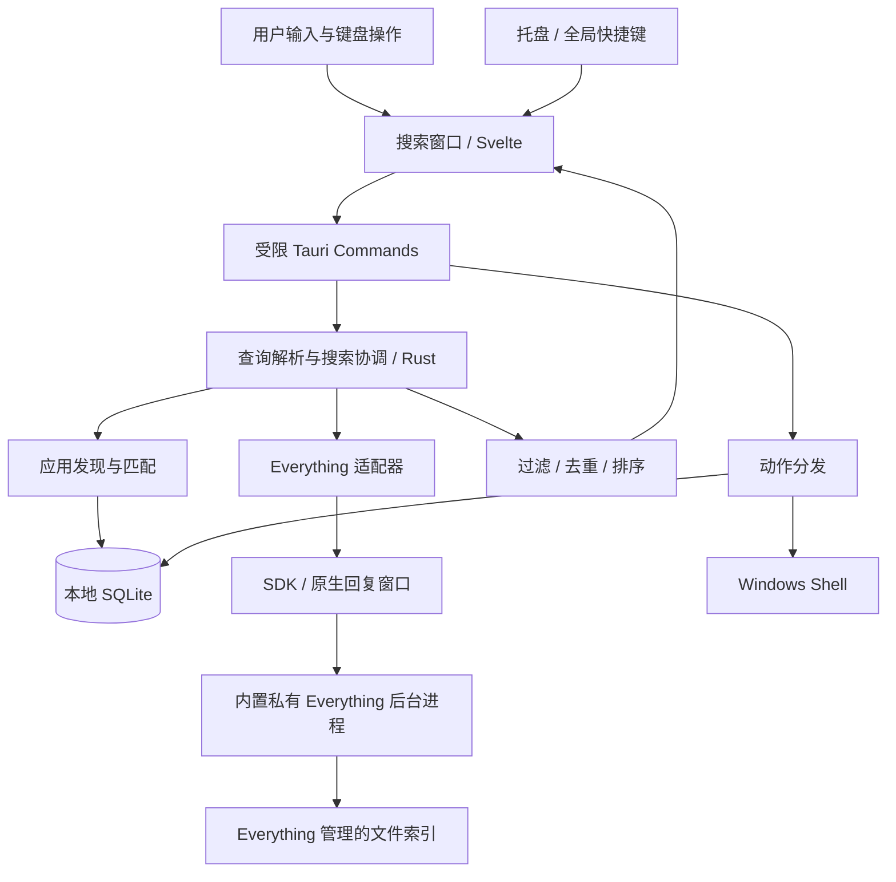
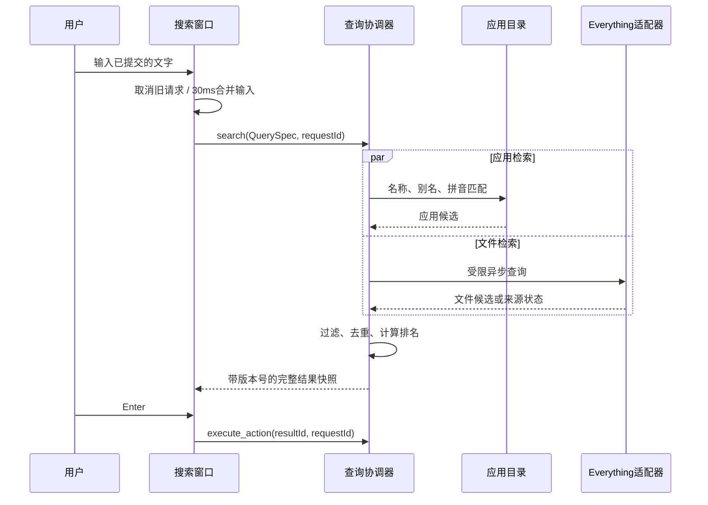

# 轻量超级搜索应用：技术设计说明书

> 2026-10-13 实施更新：0.1.4 内置独立隐藏的 Everything 1.4.1.1032；采用普通权限目录索引，禁用卷自动包含与外部服务连接；默认 680×60 中性灰搜索栏。本文其余原始架构/目标应结合第30章的最终实现差异阅读，发布与性能数字均以验收记录为准。

> 2026-10-12 修订：界面改为简体中文；空闲为单一搜索栏；每次呼出清空输入；已成功打开的匹配项优先。本文中的资源与性能指标仍是验收目标，实际测量以最新验收报告为准。

版本：0.1.4（已实现的本地测试版；性能与完整发布验收仍未完成）  
日期：2026-10-13  
产品名称：SuperSearch。  
交付性质：产品需求、架构设计、接口约定、测试验收和开发路线；已交付 Windows 程序与安装包，当前实证见验收记录。

阅读导航：第 1～3 章是需求与选型；第 4～10 章是架构、搜索与数据；第 11～17 章是接口、动作、权限、性能与恢复；第 18～23 章是代码组织、测试与发布；第 24～29 章是验收、里程碑、风险和资料依据。

## 1. 设计结论与已确认需求

本项目要做一个专注搜索的 Windows 桌面应用。用户按快捷键呼出搜索框，输入应用名或文件名，使用键盘选择并打开结果。产品价值是把应用启动和文件查找集中到一个简单入口。

以下需求已经由用户明确确认：

| 项目 | 已确认结论 | 对设计的影响 |
| --- | --- | --- |
| 首版搜索范围 | 应用启动＋文件/文件夹名称搜索 | 不实现文件正文搜索 |
| 首版操作系统 | 只支持 Windows | 文件发现、快捷键和启动行为围绕 Windows 设计 |
| “臃肿”的主要问题 | 功能太多，只想保留搜索 | 优先控制产品边界，资源占用也必须可测量 |
| 文件引擎依赖 | 可以依赖 Everything，优先复用 | 首版不自建全盘文件索引 |
| 当前任务 | 紧凑 UI 与内置后台文件引擎 | 用户已明确选定无需另装 Everything 的集成方案 |

推荐方案：**Tauri 2＋Rust＋轻量前端＋Everything SDK**。应用发现和排序由本应用负责；文件与文件夹名称检索由 Everything 负责；SQLite 只保存应用目录、别名、固定项和使用统计。

这是一项设计建议，不是用户指定的技术栈。若后续提出“后台必须低于 50 MiB”这样的严格限制，应重新评估原生 Windows UI，不能将当前选型当成既定事实。

### 1.1 本文采用的默认决策

为使方案可执行，下列细节先给出明确默认值，评审时可以逐项调整：

| 决策 | 默认值 | 决策依据 |
| --- | --- | --- |
| 平台基线 | Windows 11 x64 | 首版收敛兼容性验证范围 |
| 其他 Windows 版本 | Windows 10 22H2 作为兼容性测试目标，非首版正式承诺 | 不把系统仍可运行等同于完整支持 |
| UI 语言 | 简体中文；原始应用/文件名保持不变 | 2026-10-12 用户最新更正优先 |
| 默认快捷键 | Alt＋Space，可修改 | 接近用户熟悉的启动器操作方式，冲突必须处理 |
| 应用启动方式 | 普通用户权限 | 日常搜索不应要求整个应用以管理员身份运行 |
| 文件范围 | Everything 当前索引范围，附加本应用的显示过滤 | 不承诺所有磁盘、网络目录天然都已索引 |
| Everything 部署 | 内置官方稳定 x64 后台程序，独立隐藏命名实例 | 不需另装或手动启动；程序承担自有进程和索引生命周期 |
| 网络行为 | 本地名称搜索离线；仅用户按 Enter 无匹配或 Shift＋Enter 时将输入交给默认浏览器的 Bing 搜索；更新采用手动下载 | 无需账号、云端服务和搜索后端 |
| 开机启动 | 默认关闭，由用户开启 | 避免未经选择增加常驻程序 |
| 退出策略 | 关闭搜索窗口只隐藏；托盘 Quit 才结束本应用 | 允许快捷键持续可用 |

“全盘搜索”在本文中表示搜索 Everything 已建立的索引，**不表示本应用绕过权限、主动扫描所有路径，或保证网络盘和云文件已完整收录**。

## 2. 产品范围与防止功能膨胀

### 2.1 首版必须有的功能（P0）

1. 全局快捷键呼出、隐藏搜索窗口，并提供托盘入口。
2. 本地已安装应用搜索、应用别名、应用启动。
3. 应用名称的英文、中文、常见拼音与拼音首字母匹配。
4. Everything 文件与文件夹名称搜索；显示名称、类型和所在目录。
5. 键盘选中、打开、打开所在位置、复制完整路径。
6. All / Apps / Files / Folders 四种范围；扩展名和目录筛选。
7. 固定常用结果、轻量的成功使用次数和最近使用时间。
8. 快捷键、开机启动、依赖状态、搜索过滤和历史清除设置。
9. Everything 缺失、未启动、索引未就绪时的明确状态和恢复入口。
10. 安装、卸载、单实例以及基础诊断。

### 2.2 首版明确不纳入的功能

| 功能 | 原因 |
| --- | --- |
| 插件市场、插件运行时、第三方脚本 | 会形成通用工具平台，增加维护和权限复杂度 |
| AI 对话、语义检索、向量数据库 | 当前需求只涉及应用与名称搜索 |
| 文件正文索引、OCR、PDF/Office 内容解析 | 额外的索引、解析和后台开销 |
| 剪贴板历史、截图、翻译、笔记、待办 | 与首版搜索主路径无直接关系 |
| 账号、云同步、团队空间 | 无必要的云端依赖 |
| 截获资源管理器、文件对话框自动填入 | 系统集成风险高，当前并未要求 |
| 文件删除、重命名、移动、批处理 | 扩大到文件管理器并引入写入风险 |
| 自研 MFT/USN 全盘索引 | 与已经选定的 Everything 复用方案重复 |
| 常驻管理员服务、自动修改索引服务 | 首版没有必要拥有这些权限与生命周期 |
| 搜索任意命令并执行、任意 Shell 参数 | 会把普通搜索变成执行入口 |

新需求进入开发前必须回答：是否缩短“输入→找到→打开”的路径？会增加哪些常驻进程、后台任务和依赖？是否能用 Windows/Everything 现有能力完成？没有明确收益的需求不进入当前版本。

### 2.3 首版用户故事

| ID | 场景 | 验收行为 |
| --- | --- | --- |
| US-01 | 按快捷键寻找应用 | 输入应用名，候选出现，Enter 启动正确目标 |
| US-02 | 输入“微信”或“wx” | 若应用已发现，支持中文名称或生成的拼音别名命中 |
| US-03 | 搜索“项目计划” | 在 Everything 已索引范围内出现名称包含对应文字的文件/文件夹 |
| US-04 | 搜索同名文件 | 展示父目录，允许区分不同位置的结果 |
| US-05 | 限定为 PDF | 选择扩展名筛选后不混入其他文件类型 |
| US-06 | 查找文件并打开目录 | Ctrl＋Enter 在资源管理器中定位目标 |
| US-07 | Everything 尚未启动 | 应用启动仍可使用，文件范围显示明确依赖状态 |
| US-08 | 连续输入并删除字符 | 旧查询不覆盖最新查询，已选中结果不意外变化 |
| US-09 | 在中文输入法中选择候选 | IME 候选确认不会同时打开搜索结果 |
| US-10 | 关闭或清除使用记录 | 清除后不再依据旧的使用统计排序 |

## 3. 技术路线比较

### 3.1 桌面框架

| 路线 | 优势 | 主要成本 | 适用判断 |
| --- | --- | --- | --- |
| A：Tauri 2＋Rust＋Svelte | 搜索窗口容易迭代；系统调用和通信可集中在 Rust；不需要捆绑完整浏览器 | Windows 依赖 WebView2；仍会存在 WebView 相关进程和内存 | 本文推荐，优先快速做出简洁、现代的搜索体验 |
| B：C#＋WPF＋Everything SDK | Windows 桌面能力成熟；输入、无障碍、系统调用整合便利 | .NET 部署方式影响安装体积；需要 C#/XAML 经验 | 若开发团队主要熟悉 C#，可直接选此路线 |
| C：Rust＋原生 Win32 控件 | 可以绕开 WebView；具备进一步压低运行时开销的空间 | UI、主题、无障碍和消息循环开发成本较高 | 适用于极严资源上限，需要原型测量后决策 |

Tauri 的进程结构和系统 WebView 架构可以在官方资料核对；“安装包较小”不等于“后台内存必然较低”。WPF 为 Windows 专用 UI 框架；Rust 也可通过微软提供的 Windows API 绑定使用原生能力。[Tauri 进程模型](https://v2.tauri.app/concept/process-model/)、[WPF 概述](https://learn.microsoft.com/en-us/dotnet/desktop/wpf/overview/)、[Rust for Windows](https://github.com/microsoft/windows-rs)。

不选择 Electron 作为首版默认：本项目界面规模很小，当前没有足以要求其完整运行时的需求。这是本项目的工程取舍，不是各框架实际性能的测试结论。

### 3.2 文件检索路线

| 路线 | 优点 | 代价 | 本项目结论 |
| --- | --- | --- | --- |
| 复用 Everything | 复用成熟的名称索引与查询能力 | 0.1.4 内置后台进程并管理目录索引；首次扫描较慢，仍需处理 IPC 状态 | 已采用，用户已确认内置方案 |
| 自建目录扫描＋数据库 | 完全独立，普通权限下可扫描用户选择的目录 | 初始扫描、监控丢事件、中文子串索引与重建都要自行解决 | 不进入首版 |
| 自建 NTFS MFT/USN 索引 | 有全盘元数据索引优化空间 | 卷权限、文件系统限制、日志断点、目录重命名等问题复杂 | 仅在未来独立版本重新评估 |

uTools 官方本地搜索页面说明其基于 Everything。Everything SDK 是对客户端的本机 IPC 接口，**客户端需要运行，0.1.4 已由本应用内置并管理；SDK 本身不能代替索引客户端**。[uTools 本地搜索](https://www.u-tools.cn/plugins/topic/51/)、[Everything SDK](https://www.voidtools.com/support/everything/sdk/)。

### 3.3 推荐依赖与版本管理

| 依赖 | 用途 | 控制原则 |
| --- | --- | --- |
| Rust stable | 后端、查询协调、Windows 集成 | 实现开始时锁定工具链，不在文档中猜测最新补丁版本 |
| Tauri 2 | 桌面壳与前后端调用 | 仅启用已使用的能力 |
| Svelte＋TypeScript＋Vite | 输入框、列表、设置 | 不引入路由框架、大型 UI 库、SSR 或额外服务 |
| Everything SDK | 文件名称与路径检索 | 使用 Unicode 接口；版本、架构和实际客户端做兼容测试 |
| SQLite / rusqlite | 应用、别名、固定项、统计 | 后端访问；不向前端开放任意 SQL |
| Windows API 绑定 | Shell、应用发现、必要的原生消息桥接 | 功能按需启用；FFI 集中封装 |
| 全局快捷键、单实例、可选开机启动插件 | 桌面基础行为 | 仅使用官方能力，首版不添加自动更新插件 |

Everything 桥接优先使用经过核对的官方 SDK 源码/库；若选择 DLL，必须放在受控安装目录并按完整路径加载。最终采用源代码静态桥接还是受控 DLL，应在第 25 章的原型里根据构建与许可核对结果固定；这不改变业务接口。

所有依赖用 Cargo.lock 和前端锁文件固定。SDK 下载来源、版本、校验值及所附许可必须记录。Rust 最低版本由锁定依赖决定，例如本次核查时全局快捷键插件页面列出的最低 Rust 版本为 1.90；开工时仍须复核。[全局快捷键插件](https://v2.tauri.app/plugin/global-shortcut/)。

## 4. 总体架构



### 4.1 模块职责

| 模块 | 唯一主要职责 | 依赖 | 明确边界 |
| --- | --- | --- | --- |
| SearchWindow | 输入、列表、选择、键盘行为 | 查询命令和结果事件 | 不枚举磁盘、不操作 SDK、不执行 Shell |
| QueryParser | 把用户输入解析为受限 QuerySpec | 无系统依赖 | 不透传任意 Everything 语法 |
| SearchCoordinator | 启动来源查询，汇总、取消、处理超时 | AppCatalog、EverythingAdapter | 不持有 UI 控件 |
| AppCatalog | 应用发现、别名和应用名称匹配 | Windows Shell、SQLite | 不扫描整个磁盘寻找 exe |
| EverythingAdapter | SDK 查询、客户端状态、结果快照 | SDK、原生回复窗口 | 不改用户的 Everything 索引设置 |
| Ranker | 统一匹配等级、使用分和去重 | 已返回候选、使用统计 | 不同步读取所有文件元数据 |
| ActionDispatcher | 打开、定位、复制路径、固定 | Windows Shell、SQLite | 不接受任意命令字符串 |
| SettingsStore | 配置校验与原子保存 | JSON、SQLite | 不把配置变成脚本入口 |
| DesktopHost | 窗口、托盘、快捷键、单实例 | Tauri、Windows | 不承担搜索逻辑 |

这些是模块边界，首版可以在同一 Rust 工程内实现，不需要微服务、额外后台守护进程或动态 Provider 插件系统。

### 4.2 进程与线程

- 本应用拥有一个 Rust 主进程及其 WebView2 相关子进程。
- Everything 为本应用管理的独立隐藏后台进程；0.1.4 使用普通权限目录索引，不依赖外部服务，只管理自有实例退出，不升级已有客户端。
- UI、托盘和快捷键运行在桌面事件循环中。
- Everything SDK 由一个专用线程串行管理，并拥有原生回复窗口和消息循环。
- 应用枚举与数据库写入在后台进行，COM 对象在符合其 apartment 要求的线程内创建、使用和释放。
- 小型应用目录的名称匹配在工作线程执行，避免阻塞窗口响应。
- SQLite 使用一个写入所有者，最多两个读取连接；不为每个字符创建新线程或新连接。

首版优先利用线程与消息队列隔离职责，不为“将来扩展”引入额外进程。Windows Explorer 图标提取可能受到 Shell 扩展影响，应使用占位图、缓存和延迟加载，不能卡住第一批结果。

## 5. 用户交互与窗口行为

### 5.1 搜索主界面

空闲窗口只包含搜索栏，不显示快捷键徽标与检查设置文字。窗口透明、无系统装饰和阴影，搜索栏外侧不留白。默认客户端区域宽 680、高 60 个逻辑像素；最小宽度 360。当前查询出现有效结果后，才展示范围切换、结果列表与轻量状态栏。最多同时显示 6 行，其余结果在列表内滚动。结果窗口高度为 154＋60×可见行数，最多 514；设置与弹窗高度 620，实际尺寸受当前显示器工作区约束。

结果行展示：类型图标、主名称、父目录/来源、可用快捷操作。完整路径在悬停提示或操作菜单中显示。文件首屏不展示缩略图、全文预览、文件大小统计和复杂工具栏。

空输入只显示搜索栏，所有范围均不请求全盘结果。每次呼出清空上次输入、结果、选择与临时状态；当前非空搜索有匹配结果时才向下展开。无匹配采用“↵ 必应搜索”入口，加载和故障采用栏内小图标及无障碍中文反馈，设置通过搜索图标、Ctrl+, 或托盘进入。

### 5.2 键盘约定

| 操作 | 默认按键 | 语义 |
| --- | --- | --- |
| 呼出/隐藏 | Alt＋Space | 切换搜索窗口；快捷键按下事件只触发一次 |
| 上下选择 | ↑ / ↓ | 保留输入焦点，移动当前候选 |
| 打开/网页搜索 | Enter | 有本地结果时打开所选项；当前查询结束且零结果时用默认浏览器进行 Bing 搜索 |
| 强制网页搜索 | Shift＋Enter | 对非空输入直接进行 Bing 搜索，包括有本地匹配、正在加载或本地语法不支持的情况 |
| 打开所在位置 | Ctrl＋Enter | 文件定位；文件夹定位到父目录；应用快捷方式定位到来源位置 |
| 复制完整路径 | Ctrl＋Shift＋C | 对具有路径的结果复制路径，不覆盖输入框常规复制 |
| 范围切换 | Ctrl＋Tab / Ctrl＋Shift＋Tab | 在全部 / 应用 / 文件 / 文件夹间循环 |
| 打开动作菜单 | Shift＋F10 | 标准键盘菜单操作；菜单自动避让窗口边界 |
| 打开设置 | Ctrl＋, | 也可点击搜索图标或使用托盘菜单 |
| 隐藏 | Esc | 菜单开启时先关闭菜单；输入法合成时遵循 IME 行为 |

Tab 保持标准焦点导航，Ctrl＋C 保持输入文字复制，避免为了快捷键破坏熟悉的编辑行为。注册 Alt＋Space 失败时保留托盘可用，并让用户选择替代键；不得静默抢占或反复重试。

### 5.3 中文输入、焦点和排序稳定

- `compositionstart` 到 `compositionend` 期间，不将合成中的文字提交为正式查询。
- IME 确认候选的 Enter 不同时触发打开；合成结束后的重复 input 需要去重。
- 新查询立即让旧结果不可执行，普通 Enter 只有在当前查询结果到达后才有效；Shift＋Enter 可对当前非空输入显式发起网页搜索。
- 同一查询第一次完整展示后，用户已移动选中项时，不自动改变其对应实体；迟到结果加入列表，但必须保留选中实体。
- `resultId` 不存在于最新列表时清空选择，不能继续按原行号执行其他结果。
- 窗口默认在鼠标所在显示器的工作区内显示，支持 DPI 切换和多显示器布局。
- 菜单、设置对话框或 IME 候选活动期间，不能单凭短暂失焦立即隐藏窗口。
- 前台激活受 Windows 限制时，允许点击托盘恢复；不模拟按键或反复抢焦点。

### 5.4 窗口生命周期

启动后创建隐藏的搜索窗口以保证首次呼出响应；搜索框隐藏后停止前端轮询、动画和结果渲染。首版使用“保留一个窗口”的策略，测量常驻内存后再决定是否提供释放窗口的省内存模式。

托盘菜单保持精简：Open、Settings、Everything Status、Quit。Settings 使用同一 WebView 中的视图，不默认增加一个长期常驻设置窗口。单实例再次启动只激活已有窗口，不重复注册快捷键。[Tauri 单实例插件](https://v2.tauri.app/plugin/single-instance/)。


### 5.4 布局同步与会话隔离

原生窗口用一个初始化标志区分首次默认定位与再次显示。记住位置模式下，后续快捷键、托盘和单实例呼出保留当前窗口中心；展开结果、设置、预览和再次收起时以此中心计算位置，并按当前显示器工作区夹取，避免结果全部向下偏移。鼠标跟随模式在呼出时居中到鼠标所在显示器；手动拖动后的中心仍作为后续尺寸变化的参考。该状态只保留在程序运行期间，不新增磁盘坐标配置。

前端通过内部命令 `sync_window_layout({ layout, rows, requestId? })` 同步 `compact`、`results`、`settings` 三种布局。结果布局必须携带捕获时的请求 ID；后端仅接受当前有效、非空且有结果的请求，并将行数限制为实际结果数与 6 的较小值。原生呼出先失效旧请求并缩小窗口，再发出显示事件。托盘打开设置同样建立新会话，清除旧弹窗、输入法合成与未完成动作状态。

前端串行发送尺寸，仅保留排队的最新布局。单次发送失败只拒绝对应等待者，继续处理新布局。来源探测使用会话版本与探测版本双重校验；其他异步动作也在返回时核对会话身份。弹窗关闭等待 DOM 恢复后归还焦点，原触发节点已移除时回到搜索输入。

## 6. 应用发现与启动

### 6.1 应用来源

| 来源 | 采集方式 | 首版行为 |
| --- | --- | --- |
| 当前用户开始菜单 | Windows Known Folder 对应目录中的快捷方式 | 核心来源 |
| 公共开始菜单 | Known Folder 对应公共目录中的快捷方式 | 核心来源 |
| 用户/公共桌面 | 读取可启动的应用快捷方式 | 可关闭；普通文档快捷方式不进入 Apps |
| Shell 应用集合 | 枚举 AppsFolder 等系统应用条目 | 用于打包应用及缺少常规 exe 路径的应用 |
| 用户手动添加 | 选择本地 exe 或快捷方式并设置显示名 | 支持免安装应用；不允许输入任意 Shell 命令 |

不要硬编码开始菜单路径，也不要全盘扫描 exe。注册表卸载项不是可靠的启动目录：它可能指向卸载器、辅助组件或没有启动目标的产品，不作为首版主来源。

快捷方式通过 Shell/COM 读取显示名、图标位置和启动目标。无法解析的条目记录单项错误，不阻塞其他应用。打包应用保留 Shell 标识，不能强制转成 exe 路径。

### 6.2 标识、去重和刷新

应用使用两层标识：`appId` 是本应用分配并持久化的稳定 ID；`launchKey` 表示启动目标。打包应用优先使用 AUMID 或稳定 Shell 标识，普通应用使用规范化的目标、参数和工作目录组合。参数不同的快捷方式可能代表不同启动模式，不能只按 exe 路径合并。

启动器中显示优先级：用户手动名称＞开始菜单名称＞系统可读名称。完全相同的启动目标合并为一个应用，并保留多个来源；不同应用即使名称相同也不能合并。

刷新策略：启动后先载入上次应用目录，再后台重新枚举；监听少量开始菜单/桌面根目录；变化 2 秒合并一次；提供手动 Refresh Apps。从休眠恢复后进行一次后台核对。只在完整成功枚举某来源后，才清理该来源的缺失项。

目录监控不能被当作绝对不丢事件的数据源。微软文档明确指出通知缓冲区溢出时需要重新枚举受影响目录，本项目据此设置补偿刷新。[ReadDirectoryChangesW](https://learn.microsoft.com/en-us/windows/win32/api/winbase/nf-winbase-readdirectorychangesw)。

### 6.3 应用名称匹配

匹配字段：显示名称、名称规范化副本、用户别名、英文单词首字母、中文拼音全拼和拼音首字母。

拼音只对小型应用目录生成；首版不复制 Everything 的全盘文件名来建立拼音索引。多音字默认取有限候选，最多生成 4 组读音组合；用户别名可以覆盖不符合习惯的读音。拼音库应在选定依赖后对词典质量和许可证做核对。

查询比较使用不区分大小写和适当 Unicode 规范化的搜索键；真实路径保持原始 UTF-16 信息，不根据规范化名称反推路径。子序列匹配用于应用简称，例如 `vsc` 匹配 Visual Studio Code；它不是文件名编辑距离搜索。

## 7. Everything 集成设计

### 7.1 接入前提与范围

接入成功须同时满足：存在兼容客户端、客户端正在运行、IPC 可用、索引已载入。Everything Service 存在仅说明可能具备索引服务，不能据此显示文件搜索可用。必须检测实际查询和索引状态。

首版兼容性基线为发布时选定的 Everything 正式版及对应 SDK。不得依赖测试版独有语法。Lite 版等不提供所需 IPC 的构建必须报告不兼容；具体版本组合记入发布矩阵。

内置索引默认覆盖可访问的本地固定磁盘，包含目录设置可缩小索引范围。设置中提供引擎状态与重试入口。目录扫描仅建立自有文件名索引，不创建/删除 USN 日志、不修改外部 Everything 配置，也不开启 HTTP/网络搜索接口。

### 7.2 状态机

| 状态 | 判定 | 用户看到的行为 | 后台处理 |
| --- | --- | --- | --- |
| NotConfigured | 没有确认的客户端位置/接入信息 | 提供配置和官方下载入口 | 应用搜索正常工作 |
| NotRunning | 兼容位置已知，未发现可用 IPC 客户端 | Start Everything / Retry | 用户点击后启动指定客户端 |
| IndexLoading | IPC 可用但索引尚未载入 | File index is loading | 窗口可见时有限重试 |
| Ready | 索引已载入且查询可用 | 正常文件检索 | 执行受限查询 |
| Unavailable | IPC 错误、版本不兼容、超时 | File search is unavailable | 指数退避，允许手动重试 |

0.1.4 启动时自动解出并启动随程序附带的已核对厂商二进制；运行时不从网页下载执行程序。引擎失败通过设置重试。搜索窗口隐藏时不循环探测来源，下一次呼出或查询再检查；一次查询失败不能误报缺失安装。

### 7.3 异步 SDK 查询

采用 SDK 非阻塞模式与专用回复窗口。官方要求非阻塞查询先配置回复窗口，并提供 Reply ID 区分请求。[Everything_Query](https://www.voidtools.com/support/everything/sdk/everything_query/)。

单一 SDK 所有者执行以下流程：

1. 验证 QuerySpec，编译为受控搜索表达式。
2. 分配 SDK reply ID，建立其与本应用 request ID 的映射。
3. 设置查询字符串、匹配规则、排序、最大条数、offset、所需字段和回复目标。
4. 非阻塞提交，启动截止时间跟踪。
5. 收到消息后验证 reply ID，通过 SDK 核验实际回复。
6. 在改变 SDK 查询状态前，把有效结果复制到 Rust 自有的 ResultSnapshot。
7. 将快照交给协调器，不能把 SDK 借用指针交给 UI 或其他线程。

SDK 的多个 setter、查询与结果读取属于一个逻辑事务，即使 SDK 说明线程安全，也不能让多个查询交错操作其共享状态。回复窗口在专用线程中运行，不能阻塞 Tauri UI 事件循环。

### 7.4 取消、超时和回复乱序

- 本应用每次输入产生单调递增的 query generation，所有事件都带上它。
- 取消意味着该请求不再发布结果；不假定 SDK 能物理取消已发送查询。
- 同一 SDK 通道保持一个有效在途请求和一个“最新待执行请求”，新的等待请求替换旧的等待请求。
- 旧请求结束或达到截止时间后发起最新请求；超时后到达的旧回复直接丢弃。
- 不以较小整数循环复用仍可能到达回复的 ID；维护有限的过期 ID 集合。
- 超时释放的是逻辑等待状态，不代表外部客户端已经停止计算；连续超时应退避并限制请求数量。
- 每个 query generation 的候选缓存和引用在取消后释放；关闭窗口后不继续发送文件查询。

查询的 250 ms 来源截止时间从协调器接受请求时计算，包含等待 SDK 通道的时间；不能等到实际提交 SDK 时才重新计时。排队时已用完预算的请求直接终止，不继续发送。这样连续输入遇到慢查询时，不会形成每个请求额外等待 250 ms 的无界队列。

### 7.5 字段与条数

第一批只请求名称、路径和区分文件/文件夹所需的字段。文件大小、时间、缩略图和预览不进入首版首屏路径。路径通过 Unicode 接口读取，按所需长度分配，不固定为 MAX_PATH 长度。

每次文件查询默认最多取得 200 个候选，UI 展示 50 个，列表首屏 10 个。“加载更多”显式请求下一页，累计已获取文件候选最多 1,000 个。后端通过 SDK 设置 max 和 offset，不能先取全部结果再在前端截断。[Everything_SetMax](https://www.voidtools.com/support/everything/sdk/everything_setmax/)、[完整路径读取](https://www.voidtools.com/support/everything/sdk/everything_getresultfullpathname/)。

文件候选采样使用固定的名称排序作为分页基础，再对已取得候选进行本应用排序。是否可采用该排序的快速索引能力需要对锁定客户端验证；若明显拖慢查询，原型阶段改用经过测量的稳定排序。

必须公开候选截断事实：本应用不宣称“对全盘所有命中文件完成全局相关性排序”。大规模泛查询优先提示加关键词或缩小目录，加载更多仍可能发现更相关结果。

## 8. 查询语法与解析

### 8.1 首版支持的输入

| 输入 | 语义 | 例子 |
| --- | --- | --- |
| 普通文字 | 应用名或文件名包含关键词 | `微信`、`report` |
| 空格分隔文字 | 每个词都要匹配，词序不限 | `年度 报告` |
| 双引号短语 | 连续名称片段 | `"project plan"` |
| `app:` | 只查询应用，后接普通文字 | `app: vscode` |
| `file:` | 只查询文件 | `file: report` |
| `folder:` | 只查询文件夹 | `folder: 项目` |
| `ext:` | 扩展名集合，忽略大小写 | `report ext:pdf`、`ext:pdf;docx` |
| `in:` | 指定目录及其后代 | `report in:"D:\Work Files"` |

实际搜索框输入 Windows 路径时使用单个反斜杠，如上表示例；只有存入 JSON 时才转义为双反斜杠。路径表达式不进行环境变量或命令替换。

范围前缀只允许一个。`app:` 与 `ext:`/`in:` 同时出现时提示 Invalid search filters，不能默默丢弃某一项。所有范围的完全空输入均保持紧凑状态；显式输入范围、扩展名或目录过滤时可查询有限候选。

### 8.2 验证与语义边界

- 原始输入最长 512 个 Unicode 标量值，最多 8 个文本词，扩展名最多 8 个；超过限制显式提示。
- 未闭合引号和未知的功能前缀返回 Invalid search query，不向 SDK 透传。
- 首版不开放 `content:`、用户正则表达式、Everything 宏和任意高级函数。
- `ext` 只接受字母、数字和有限的正常扩展名字符；去掉可选前导点，规范化后编译。
- `in` 必须为本地绝对目录路径；网络 UNC 路径不进入首版保障范围。
- 普通词不解释为 Everything 控制语法。AST 序列化需要对引号、分组和保留操作符逐项验证；不能把 SQL 参数化当作 Everything 语法转义方案。
- `*`、`?` 等通配符首版不开放；`!` 等合法文件名符号需要作为字面字符处理，若锁定引擎无法可靠表达，则明确报不支持该字符，不能悄悄变成排除操作。
- 实际名称包含中文两字或单字时，按 Everything 的名称检索处理，不引入依赖“三个字符”的本应用 FTS 规则。

QueryParser 返回结构化 QuerySpec，EverythingAdapter 只接受它。Everything 本身包含文件内容搜索等更广的语法；首版必须通过解析边界阻止其进入日常名称查询。[Everything 搜索语法与行为](https://www.voidtools.com/support/everything/searching/)。

### 8.3 路径筛选

目录范围采用“该目录中的后代条目”，不自动返回根目录本身。生成引擎路径表达式时明确保留目录边界，避免 `D:\Work` 同时匹配 `D:\WorkBackup`。该规则要覆盖带空格、中文、结尾分隔符与目录不存在的情况。

Windows 路径用于显示、筛选、去重和执行的规则分别定义。普通搜索词可以规范化；真实路径不做 NFKC 等可能改变文件名的转换。路径比较考虑大小写规则，并对启用大小写敏感的目录保留不同条目。

## 9. 搜索流水线与相关性排序

### 9.1 流水线



本图表达正常路径。应用来源可以先发布首批结果，随后文件来源发布合并快照；文件失败时应用结果仍可使用。文件范围则不发送不相关的应用查询。

### 9.2 请求调度

前端默认输入合并窗口为 30 ms；它只减少连续输入请求，不与后端再叠加一次同等延迟。窗口内同一内容与过滤条件不重复提交。应用查询目标时间为 20 ms，文件查询截止时间为 250 ms，前端 150 ms 尚无文件回复时显示轻量加载状态。

所有首批和补充结果采用**完整快照**，不用难以验证的行级增量补丁。`snapshotRevision` 单调增加，前端拒绝旧 revision。每个查询最多发布应用首批与文件合并等少量快照，图标更新单独使用资源缓存，不为了每个图标重新排列结果。

### 9.3 匹配等级与排序键

排序先区分是否成功打开过：仍匹配当前搜索的已使用项目优先于未使用项目；组内依次比较匹配等级、固定状态、受限使用分、稳定名称和稳定实体 ID。历史记录不能让无关项目通过过滤。关闭记录或清除历史后不依据旧使用统计排序。

| 等级 | 条件 | 优先级 |
| --- | --- | --- |
| M0 | 应用名称/别名，或文件完整名称精确匹配 | 最高 |
| M1 | 应用名称或文件名称前缀匹配 | 次高 |
| M2 | 所有输入词在名称中匹配，连续短语按用户输入要求验证 | 普通包含匹配 |
| M3 | 应用拼音全拼或拼音首字母匹配 | 次于直接名称匹配 |
| M4 | 应用单词首字母或受限子序列匹配 | 最低的有效匹配 |

文件默认不做拼音或编辑距离匹配。路径只用于显式 `in` 筛选，或未来经确认的路径模式，不把父目录中的词默认当成文件名命中。

同等级使用分初始采用：频次贡献 `min(12, 2 × ln(1 + launchCount))`；最近使用在 1 天内加 6，7 天内加 3，30 天内加 1。数值为设计初值，要通过第 24 章的黄金查询集验证。固定项只在当前有效匹配的同等级内提高优先级，不能让无关固定项占据查询结果。

### 9.4 来源合并、候选限制与公平性

Apps 最多提供 50 个候选，Everything 每页提供 200 个。All 模式使用统一排序，不再用来源保留位置覆盖已使用项目优先级。匹配历史文件在引擎分页前补入有限候选，读取文件元数据前先筛选并排序，剔除已删除或不满足隐私设置的目标；补入范围限于先排序选出的最多 50 个历史/固定文件候选；这些候选不会仅因未进入首批 200 个引擎候选而丢失，不保证枚举整份历史。

精准匹配提升只针对已经取得的候选。若黄金查询显示“精确名称被 200 条候选淹没”，允许在第二阶段增加一个同过滤条件的精确名称补充查询；该查询仍受请求总预算和串行 SDK 通道约束，不是首版默认必做的三倍查询。

加载更多以引擎固定排序的 offset 继续获取候选；文件变更可能导致页间重复或遗漏，因此前端跨页去重，但不提供强一致性的无限滚动承诺。

### 9.5 去重与结果稳定性

应用以 launchKey 去重；普通文件/文件夹以规范化路径及大小写敏感性信息去重。硬链接、同名不同目录和不同参数的快捷方式不视为同一实体。

只有当应用快捷方式与文件来源中的同一路径能够可靠对应时，才合并重复行并保留相关动作。不能仅凭同名或同一 exe 强行合并。来源更新使用稳定 `entityId` 保持键盘选择，不按位置绑定动作。

## 10. 数据模型与本地存储

### 10.1 数据范围

本应用不复制 Everything 的全量文件目录。只持久化应用目录、应用别名、用户固定项、成功使用统计与设置。普通文件搜索候选只存在于当前结果缓存；文件被使用或固定后才保存其路径定位信息。

本地数据目录由 Tauri 按 com.supersearch.desktop 应用标识确定，内置引擎位于其 engine/1.4.1.1032 子目录。数据库和 WebView 用户数据位于本地磁盘，不置于网络共享目录或云同步根目录。

| 文件 | 内容 | 默认上限/策略 |
| --- | --- | --- |
| `config.json` | 经校验的用户配置 | 原子替换，保留上一份可读备份 |
| `state.db` | 应用、别名、固定项、使用统计 | 业务数据目标小于 20 MiB；超过后执行有界清理 |
| `cache/icons/` | 处理后的小图标 | 20 MiB；按最少使用淘汰 |
| `logs/` | 去敏后的运行诊断 | 最多 3 个文件，每个 2 MiB |
| `webview/` | WebView2 用户数据与缓存 | 单独测量，不算作本应用文件索引 |

### 10.2 逻辑表结构

| 表 | 主要字段 | 约束和索引 |
| --- | --- | --- |
| `apps` | app_id、display_name、search_name、launch_kind、launch_descriptor、launch_key、icon_key、updated_at | app_id 主键；launch_key 唯一；launch_descriptor 为后端结构化编码 |
| `app_sources` | source_id、app_id、source_kind、source_locator、last_seen_generation | source_id 主键；app_id 外键；同一来源定位符唯一 |
| `app_aliases` | app_id、alias、normalized_alias、alias_kind | app_id 与 normalized_alias 联合唯一；包含用户、拼音和首字母类别 |
| `usage_stats` | entity_id、entity_kind、locator、success_count、last_success_at | entity_id 主键；last_success_at 索引；最多 5,000 条 |
| `pins` | pin_id、entity_id、entity_kind、locator、label、created_at | entity_id 唯一；最多 100 条；用户标签不改变启动目标 |
| `schema_meta` | schema_version、applied_at | 有序迁移版本；拒绝不支持的更高版本写入 |

文件实体默认按路径定位，因此文件改名或移动后，原固定项不保证自动跟随。首版表现为 Unavailable 并允许重新选择或删除固定项，不能用“搜索同名文件”偷偷替换用户的目标。

应用目录刷新后用内存快照进行名称匹配。预计应用数量为数百至数千个，可以线性扫描候选并保持清晰边界；只有测量证实不足时才增加复杂的倒排索引。

### 10.3 数据库一致性

- 使用事务提交应用刷新；新一代来源快照完整成功后再清理旧来源。
- SQLite 外键启用；统计写入只在动作得到明确成功受理后发生。
- 可以使用 WAL 降低读写互相阻塞，但控制读事务时长和 checkpoint，避免 WAL 无界增长。
- 索引、统计和配置的持久化成功分别报告，不用一个“启动成功”掩盖配置失败。
- 备份数据库采用 SQLite 支持的备份方法或在关闭连接后复制，不能在 WAL 活跃时只复制主数据库文件。
- 正常退出关闭数据库；崩溃后由数据库恢复事务，不把“最近正在查询”状态存为必须恢复的任务。

统计同时受 5,000 条和 locator 逻辑数据 8 MiB 的上限约束，优先清理最久未成功使用的非固定项目。固定项受 100 条和 locator 逻辑数据 8 MiB 上限约束，达到限制时提示用户清理，不能静默删除固定项。数据库 20 MiB 是整体目标；页分配、索引及 WAL 需要单独测量，维护操作只在空闲且有明确收益时执行。

SQLite WAL 需要本机共享内存机制支持，并有 checkpoint 与长读事务方面的约束，本文据此将数据库限定在本地目录。[SQLite WAL](https://www.sqlite.org/wal.html)。

### 10.4 隐私与历史

不默认保存完整查询字符串；只保存成功打开的实体统计。设置提供“清除使用记录”和“记住成功打开的项目”，关闭后不再写入或使用旧频次与最近使用时间。关闭记录不会删除用户主动固定的项目，清除固定项是独立操作。

默认不发送遥测。诊断日志记录来源、错误码、计时和条数，不记录文件名、完整路径或查询文字。导出诊断报告时展示包含项，让用户主动选择是否附加已脱敏环境信息。

## 11. 前后端接口契约

### 11.1 设计原则

首版接口是本应用内部的 Tauri Commands，不是本地 HTTP 服务。没有 localhost 监听端口，也不让第三方网页调用搜索或启动能力。字段名、枚举和错误消息使用英文。

前端只提交查询、过滤选择和动作类型。动作目标由后端保存的当前结果快照解析，不能提交一个任意路径或命令要求后端执行。所有入参在 Rust 边界再次校验，前端校验仅用于交互提示。

### 11.2 命令列表

| 命令 | 输入 | 返回/事件 | 规则 |
| --- | --- | --- | --- |
| `start_search` | requestId、rawQuery、scope、filters、pageSize | SearchAccepted，随后 search_snapshot | requestId 在当前窗口会话内唯一；pageSize 上限 50 |
| `cancel_search` | requestId | CancelAccepted | 幂等；取消发布和等待，不保证取消引擎计算 |
| `load_more` | requestId、cursor | 新 SearchSnapshot | cursor 为后端签发的查询绑定令牌；过期则拒绝 |
| `search_web` | rawQuery | Result<(), String> | 固定 HTTPS Bing 域名；URL q 参数编码，最多 512 字符，拒绝空白/控制字符；浏览器受理后隐藏窗口，不写入本地使用统计 |
| `execute_action` | requestId、resultId、action | ActionOutcome | 验证结果属于当前查询；默认不接受外部参数 |
| `get_settings` | 无 | SettingsSnapshot | 不暴露内部缓存、执行描述符或数据库位置细节 |
| `update_settings` | settingsVersion、patch | 新 SettingsSnapshot | 乐观版本检查；只允许白名单字段 |
| `refresh_apps` | 无 | RefreshAccepted＋apps_status | 同一时刻只进行一次刷新 |
| `get_provider_status` | 无 | ProviderStatusSnapshot | 状态有最后检测时间，不伪装成持续实时状态 |
| `start_everything` | 无 | ActionOutcome | 使用已确认客户端位置；前端不能临时提供可执行路径 |
| `set_everything_location` | 原生文件选择结果的后端令牌 | ProviderStatusSnapshot | 校验位置和兼容性，不直接接受网页生成的路径 |
| `add_app` | 原生选择令牌、displayName、aliases | AppEntry | 允许 exe/lnk 等明确定义类型，不接受 Shell 语句 |
| `set_pin` | requestId、resultId、enabled、label | PinState | 必须指向有效后端结果；label 长度有上限 |
| `remove_pin` | pinId | PinState | 可移除失效固定项；不会尝试打开或搜索替代目标 |
| `clear_usage_history` | 无 | ClearOutcome | 用户主动操作，结果包括删除条数 |

后端主动事件只有 `search_snapshot`、`provider_status`、`apps_status` 等少量类型。事件统一携带窗口会话标识；窗口重建后不得接收前一会话的回复。

### 11.3 QuerySpec

| 字段 | 格式 | 说明 |
| --- | --- | --- |
| `requestId` | 不透明字符串 | 前端请求标识，不直接映射到 SDK 内存地址或窗口句柄 |
| `scope` | all / apps / files / folders | 全局范围 |
| `terms` | 字符串数组 | 已解析普通名称词 |
| `phrases` | 字符串数组 | 必须连续匹配的名称片段 |
| `extensions` | 字符串数组 | 规范化扩展名，不含点 |
| `directory` | 路径描述或 null | 后端校验的本地目录范围 |
| `pageSize` | 整数 | 1～50 |

UI 使用 rawQuery 输入，QuerySpec 由 Rust 解析生成，不能信任来自前端的“已解析”字段绕过语法校验。

### 11.4 结果快照示例

以下是协议示例，不是实现代码。`title` 可以为中文文件名；`subtitle` 是适度截断的展示位置，完整定位信息留在后端。

```json
{
  "requestId": "q-1042",
  "snapshotRevision": 2,
  "scope": "all",
  "complete": true,
  "items": [
    {
      "resultId": "r-f81a",
      "entityId": "app-7d23",
      "kind": "application",
      "title": "Visual Studio Code",
      "subtitle": "Start menu",
      "iconKey": "icon-vscode",
      "matchTier": "M1",
      "highlights": [{ "start": 0, "end": 6 }],
      "actions": ["open", "reveal", "pin"]
    }
  ],
  "providers": [
    { "id": "apps", "status": "ready", "elapsedMs": 4 },
    { "id": "everything", "status": "ready", "elapsedMs": 31 }
  ],
  "truncated": false,
  "hasMore": false,
  "cursor": null
}
```

`complete=true` 只代表该请求的来源已完成或已终止，不代表所有磁盘都完成索引。`truncated` 表示候选或展示受到上限限制。`hasMore` 表示仍能继续请求更多候选；达到 1,000 条会话上限后，truncated 可以为 true 而 hasMore 为 false。

`highlights` 的 start/end 是 UI 字符串的 UTF-16 code unit 半开区间，必须对代理项、组合字符和 emoji 测试；无法正确映射的拼音命中可以不提供高亮。不能把 Rust UTF-8 字节偏移直接给 JavaScript 切片。

单个快照只发送最多 50 项，序列化载荷目标小于 256 KiB。后端缓存保留实际完整路径；UI 展示用路径可以截断，复制/执行动作不使用被截断文本。

### 11.5 错误结构

```json
{
  "code": "EVERYTHING_UNAVAILABLE",
  "message": "File search is unavailable. Application search is still available.",
  "retryable": true,
  "requestId": "q-1042"
}
```

错误对象不包含原始 SDK 指针、SQL、完整环境变量或未脱敏路径。用户需要定位具体目标时，由对应操作界面显示其已选择项目，不写入普通诊断日志。

## 12. 文件与应用动作

### 12.1 支持动作

| 类型 | Open | Reveal | Copy path | Pin |
| --- | --- | --- | --- | --- |
| 普通文件 | Windows 默认关联程序 | 在资源管理器选中该文件 | 完整原始路径 | 保存路径定位信息 |
| 文件夹 | 在资源管理器打开 | 在其父目录选中 | 完整原始路径 | 保存路径定位信息 |
| 快捷方式应用 | 通过其已发现的 Shell 启动描述符 | 定位来源快捷方式 | 有文件来源时可用 | 保存 appId |
| 打包应用 | 使用 Shell 应用标识启动 | 没有普通路径时不提供 | 不伪造 exe 路径 | 保存 appId |

Open 通过 Windows Shell 的受支持接口完成；Reveal 使用 Shell 定位 API，避免拼接 `explorer /select,...` 的字符串。文件名中的空格、逗号、中文和特殊符号不能改变命令含义。[Windows Shell 启动接口](https://learn.microsoft.com/en-us/windows/win32/shell/launch)。

普通文件中包含 exe 或脚本时，默认打开可能执行它们。UI 必须显示正确类型和 Launch/Open 语义；动作只能在用户选中并确认执行后发生，不能因搜索、预览或图标加载而自动运行。

搜索和复制必须保留长路径，应用清单和内部 API 选择应按 Windows 长路径能力验证。实际打开仍受 Shell 与目标程序支持范围影响；不能把“名称检索支持长路径”等同于任意关联程序都能读取它。打开不兼容时返回可理解的失败，并保留复制完整路径动作。

### 12.2 执行一致性

动作分发依次校验窗口会话、requestId、resultId、允许动作、后端描述符和目标状态。修改筛选、输入新字符、取消查询后，旧 resultId 不再可执行。执行前做存在性检查，并处理检查后目标仍被删除的竞争；最终以 Shell 返回结果为准。

启动“成功”定义为操作系统已接受启动请求，不能宣称目标应用已完全打开或文件内容已经显示。文件存在性检查成功也不代表当前用户拥有读取权限。

执行成功后隐藏搜索窗口，再异步保存使用统计；执行失败保留窗口并显示 File is no longer available 或 Unable to open this item。复制路径成功无需增加启动次数。Reveal 单独统计为可选后续需求，首版不影响启动排名。

## 13. 权限与安全边界

### 13.1 权限模型

本应用与内置引擎均普通用户运行，不安装或借用索引服务，不继承服务身份。搜索结果可见不等于文件仍可访问，实际打开由当前用户权限控制；范围与目录存在性再次校验。

不通过受保护文件的名字推断用户有读取权限，不绕过 ACL，不以管理员常驻搜索窗口解决单项访问失败。不提供首版 Run as administrator 动作；未来确有需求时应单独设计。

### 13.2 前端与 IPC

- 仅加载随安装包提供的本地 UI，禁止主搜索 WebView 导航到第三方页面。
- CSP 默认不开放远程脚本，不使用 eval；样式能力仅按实际构建产物需要开放。
- 文件名、别名、路径和错误文本按文本渲染，不用 `innerHTML` 拼接结果。
- Tauri capabilities 限定窗口和所需命令；不直接授予任意 Shell、任意文件系统或数据库 SQL 执行权限。
- 自定义 Rust commands 仍必须自行验证参数。不能把插件 capabilities 的范围控制误认为自定义命令天然都安全。
- 图标资源由后端返回内部资源标识，不能让前端请求任意磁盘文件作为图片。
- 配置文件中的路径、列表和枚举经过相同的边界校验；手改配置不能扩大执行能力。

Tauri 能力机制用于约束可调用权限与窗口范围，应与自定义命令的应用层检查同时使用。[Tauri Capabilities](https://v2.tauri.app/security/capabilities/)。

### 13.3 FFI 与客户端通信

FFI 中的字符串、缓冲区、窗口句柄和生命周期在独立适配模块封装。所有 unsafe 代码说明前置条件、所有权和释放责任，注释使用中文。SDK 所有者线程结束前停止新查询、关闭回复窗口并清理 SDK 状态。

不对原生消息中的地址自行解引用；采用 SDK 规定的回复验证机制。SDK 回复仍属于外部数据，名称长度、路径长度、条数和字段类型必须校验。错误格式不能导致 panic 穿过原生窗口回调。

如使用 DLL，禁止从当前工作目录或未经确认的 PATH 自动寻找同名 DLL。SDK 桥接文件随本应用受控部署，架构与应用一致。Everything 客户端路径只允许用户确认后的本地目标；不自动执行搜索结果中名字恰好为 Everything.exe 的文件。

### 13.4 本地数据

不保存账号令牌或云端凭据。SQLite 并非加密容器；路径与使用记录受用户数据目录访问权限保护，不能宣传为本机其他同权限程序不可读取。提供禁用统计和清除数据入口即可满足首版的实际数据范围。

## 14. 性能预算与测量口径

**本章数字全部是待原型验证的目标，不是已测结果，也不是官方框架保证。** 用户主要要求功能简洁，因此预算应防止无谓开销，而不在原型前承诺极端低内存。

### 14.1 参考环境与数据集

- 参考硬件：4 核以上 x64 CPU、16 GiB 内存、NVMe SSD。
- 系统：Windows 11 x64；记录具体 build、WebView2、Everything、SDK 和应用版本。
- 应用目录：至少 1,000 个条目，含重复名称、中文、英文及多启动模式。
- 文件索引：A 组 100,000 条、B 组 1,000,000 条；索引由 Everything 事先完成。
- 文件名组成：至少 30% 中文，含一字/两字词、空格、emoji、长路径及同名不同目录。
- 压测查询：100 条固定查询，重复多轮达到至少 1,000 次，记录 p50/p95/p99。

冷启动、暖启动、索引加载、首次图标提取和持续搜索分别记录。不能在暖缓存测试中包含少量冷请求，却把混合平均值称为冷启动性能。

### 14.2 延迟与资源目标

| 指标 | 初始目标 | 精确定义 |
| --- | --- | --- |
| 暖呼出 p95 | ≤120 ms | 已驻留且隐藏的窗口，收到快捷键到输入框可键入 |
| 冷启动 p95 | ≤2 s | 进程创建到主界面可输入；Everything 已就绪 |
| 应用首批结果 p95 | ≤80 ms | IME 正式提交文字到首批列表绘制，包含 30 ms 输入合并 |
| 文件首批结果 p95 | ≤150 ms | B 组索引已就绪，正式输入到首批文件列表绘制 |
| 文件来源终止上限 | ≤300 ms | 包括输入合并、250 ms 查询截止和发布开销；超时也算终止 |
| 动作受理反馈 p95 | ≤150 ms | 按 Enter 到 Shell 受理/失败反馈，不含目标应用自身启动 |
| 本应用隐藏时内存 | 进程树 Private Bytes 目标 ≤150 MiB | 含本应用拥有的 WebView 子进程；加载应用目录后的稳定值 |
| 本应用可见时内存 | 同口径目标 ≤200 MiB | 最多 1,000 个已获取候选与图标缓存；不含外部 Everything |
| 空闲 CPU | 5 分钟平均 ≤0.5% | 占整机可用 CPU，总和包含本应用拥有的子进程 |
| 日常空闲磁盘写入 | 目标每分钟 <1 MiB | 无刷新、无用户动作、无更新时，本应用进程树写入 |
| 本应用安装包 | 目标 ≤20 MiB | 不捆绑 WebView2 离线运行时、不捆绑 Everything 客户端 |
| 业务状态数据库 | 目标 ≤20 MiB | 不含图标、WebView 数据、SDK 和 Everything 自身索引 |

内存预算是不同阶段的发布门槛；超出时先定位增量来源，再决定优化或公开调整预算，不能只把 WebView/Everything 排除后声称整套应用更省资源。

### 14.3 依赖资源的披露

性能报告必须同时显示：本应用进程树、Everything 客户端/服务和整套组合的内存、CPU、磁盘占用。已运行 Everything 的电脑可以另外报告“新增开销”，但不能把新增开销当成总开销。

安装体积同样区分本应用、WebView2 运行时和 Everything。缺失运行时需要联网安装时，提示额外下载；“20 MiB 安装包”并不意味着无依赖环境只需要 20 MiB。Tauri 官方提供下载引导、离线和固定版本运行时等不同部署方式，本项目选择默认引导模式，不在首版捆绑固定 WebView2。[Tauri Windows 安装](https://v2.tauri.app/distribute/windows-installer/)。

### 14.4 开销控制

- 不全盘扫描 exe，不创建第二套文件索引。
- 不在每次输入时拉取所有文件结果，不读取每条结果的大小和时间。
- 只缓存当前查询、有限已获取候选和最近 64 个小型查询快照；查询缓存总上限 8 MiB，TTL 2 秒，执行前仍做校验。
- 单次请求候选总内存上限 16 MiB，超限标记截断；达到预算不能静默丢失状态。
- 后端图标缓存 20 MiB，前端仅缓存可见和最近使用图标，总目标 5 MiB。
- 主列表最多 50 行，不因“虚拟列表”而让前端保留百万项。
- 隐藏窗口不循环定时刷新来源，不播放动画，不检查网络更新。
- 应用刷新与数据库维护在用户查询时降低优先级，不阻塞首屏路径。

### 14.5 框架决策复核门槛

先做搜索窗口＋快捷键＋Everything IPC 的可测原型。若应用保持一个简单窗口仍明显超出内存/呼出预算，先排查非必要进程、图标、缓存和前端循环；若壳本身占用主导且资源上限成为首要需求，再比较 C# WPF 或 Rust 原生 Win32 原型。此时再做迁移决定，避免先投入大量业务 UI 后才发现预算不适合。

## 15. 缓存、刷新与文件一致性

本应用的文件缓存不声称强一致。Everything 维护索引更新，本应用接受短期名称结果缓存和文件系统变化之间的窗口，动作执行负责最终验证。

| 对象 | 缓存/刷新规则 | 失效方式 |
| --- | --- | --- |
| 应用目录 | 启动载入，后台刷新，来源监控，手动刷新 | 刷新成功后按来源 generation 更新 |
| Everything 查询 | 最多 2 秒的小型缓存 | 到期、来源状态变化、显式重试；后端仍保留当前请求身份 |
| 图标 | 图标来源定位符与版本/修改时间组成 key | 应用刷新变化、文件替换或缓存淘汰 |
| 使用统计 | 本地小型内存快照 | 成功启动、清除历史、关闭记录后更新 |
| 固定文件 | 路径描述符，非空查询先匹配、再检查最多 50 个候选 | 空输入不访问固定路径；查询候选需通过存在性、类型与属性检查 |

Everything 未就绪时不返回普通查询缓存冒充当前可用结果；固定文件可单独显示，但必须通过文件存在性校验后提供动作。删除文件动作失败后，从当前快照中移除或标记失效并清除对应查询缓存。

云盘仅本地占位文件可以按名称出现，打开可能触发系统下载；本应用不预先读取内容。网络盘、外置盘和非 NTFS 目录的覆盖取决于 Everything 的配置和实际索引状态，不在首版硬性 SLA 中。

## 16. 配置设计

只暴露用户有理由调整的选项。线程数、FFI 缓冲区、数据库连接数、SDK 请求 flags 和 UI 内部版本都不是普通设置项。

```json
{
  "schemaVersion": 1,
  "shortcut": "Alt+Space",
  "launchAtLogin": false,
  "defaultScope": "all",
  "historyEnabled": true,
  "theme": "system",
  "fileSearch": {
    "engine": "everything",
    "clientPath": null,
    "autoStartClient": false,
    "instanceName": "",
    "includeDirectories": [],
    "excludeDirectories": [],
    "showHidden": false,
    "showSystem": false
  }
}
```

`instanceName` 默认对应默认客户端，仅在用户明确使用多实例时设置。适配器须验证选定 SDK 支持目标实例；不支持时说明限制，不连接另一个实例假装成功。

默认隐藏 Hidden/System 属性的文件结果，属性不足或锁定 SDK 不支持相应筛选时不得默默绕过；先在兼容矩阵验证其查询/返回能力。这是本应用的显示过滤，不修改 Everything 的全局索引。

includeDirectories 为空表示采用 Everything 的已索引范围；多个 include 路径取并集，再减去 exclude 路径。限制为本地绝对目录，禁止命令替换。目录边界处理与第 8 章一致，隐藏过滤适用于文件来源，不误删应用来源中的开始菜单系统快捷方式。

配置保存采用写临时文件→刷新→同目录原子替换的方式，失败保留上一个可用版本。未知 schemaVersion 不能用默认值覆盖原配置。快捷键变更先尝试注册新键，成功后再撤销旧键，失败保持原配置；开机启动设置变更只有系统注册成功才保存为已开启。

## 17. 错误与恢复矩阵

| 错误码 | 触发条件 | 显示文案 | 恢复行为 |
| --- | --- | --- | --- |
| `INVALID_QUERY` | 非法语法、未闭合引号、超长输入 | Invalid search query | 修正输入，不提交文件查询 |
| `INVALID_FILTER` | 冲突范围、非法目录/扩展名 | Invalid search filters | 保留输入与过滤，标记问题项 |
| `SHORTCUT_CONFLICT` | 全局快捷键注册失败 | This shortcut is unavailable | 使用托盘，选择新快捷键 |
| `EVERYTHING_NOT_RUNNING` | 配置位置已知但没有可用客户端 | Start Everything to search files | 提供 Start / Retry，应用来源继续 |
| `EVERYTHING_INDEX_LOADING` | 客户端索引未载入 | File index is loading | 可见时重试；不把它当空结果 |
| `EVERYTHING_UNAVAILABLE` | IPC 错误或版本不兼容 | File search is unavailable | 退避，展示状态详情 |
| `SEARCH_TIMEOUT` | 超过来源截止时间 | File search took too long | 应用结果继续；重试或收窄查询 |
| `STALE_RESULT` | 动作对应旧请求或旧窗口会话 | Search results have changed | 拒绝执行，使用当前结果 |
| `TARGET_MISSING` | 文件或应用目标已不存在 | This item is no longer available | 移除当前候选，固定项标为失效 |
| `ACCESS_DENIED` | 打开操作权限不足 | You do not have permission to open this item | 保留窗口，不自动提权 |
| `DATABASE_UNAVAILABLE` | 数据库无法打开或读取 | Local application data is unavailable | 文件来源保持可用；应用来源临时重新枚举 |
| `CONFIG_SAVE_FAILED` | 配置写入失败 | Settings could not be saved | 保留上一个已保存状态，提示重试 |

没有命中与来源不可用是两种不同状态。只有来源成功完成且结果为空时才显示 No results。All 范围的任一来源故障只降级该来源，不把全部搜索窗口置为不可用。

数据库损坏时先保留原文件和 WAL 等关联文件，停止写入，并提供 Reset local data 入口；用户选择重置后再建立新库。统计和固定项不能被悄悄删除。首版恢复重点是来源隔离和保留用户数据，而非复杂的自动修复系统。

## 18. 跨平台边界与未来扩展

首版只交付 Windows，当前不为 macOS/Linux 实现 Provider，也不搭建跨平台插件协议。搜索协调、查询模型和排序尽量不直接依赖 HWND，便于未来重用；Windows 集成留在平台模块。

如果以后进入其他平台，文件索引来源、应用发现、权限、启动描述符和全局快捷键都需要重新设计。不能因为 Tauri 可跨平台就声称 Everything 的文件搜索也能直接迁移。

若未来用户要求完全独立文件搜索，应另立设计版本，至少覆盖：用户目录扫描、通知丢失后的补偿、目录重命名、Unicode 子串与短词索引、初次构建和重建预算，以及 NTFS/非 NTFS 的差异。SQLite trigram 对少于三个 Unicode 字符的全文查询有明确限制，不能将其直接称为解决中文两字文件检索的通用方案。[SQLite FTS5 trigram](https://www.sqlite.org/fts5.html#the_trigram_tokenizer)。

## 19. 建议代码组织

以下目录是未来实施建议，不代表本交付已经创建工程。以一个桌面应用工程开始，避免拆成大量只存在接口的库。

```text
quickfind/
  src/
    App.svelte
    SearchWindow.svelte
    ResultList.svelte
    SettingsView.svelte
    api.ts
    search-state.ts
    styles.css
  src-tauri/
    src/
      main.rs
      lib.rs
      commands.rs
      model.rs
      search.rs
      query.rs
      ranking.rs
      apps.rs
      everything.rs
      actions.rs
      storage.rs
      settings.rs
      windows/
        shell.rs
        sdk_bridge.rs
        app_discovery.rs
    capabilities/
    migrations/
    tauri.conf.json
  tests/
    fixtures/
    golden-queries/
  docs/
    design.md
    compatibility-matrix.md
    performance-report.md
  Cargo.lock
  package.json
  frontend-lockfile
```

实际文件可以合并或拆分，按职责与可读性决定，不需要为一个实现创建 factory/registry。`frontend-lockfile` 表示最终选用包管理器的锁文件，不是一个要原样创建的文件名。

遵循本会话工程约定：代码注释、应用界面与文档使用中文，技术标识和诊断日志使用英文。用户最新界面语言更正覆盖此前约定。FFI 前置条件、路径处理和刻意采用的复杂度上限必须写明。参数类型是否显式声明遵循语言本身和编译器要求，本约定不覆盖 Rust 必要的类型声明。

## 20. 测试策略

### 20.1 单元测试

重点测试会改变查询含义或执行目标的逻辑：

| 模块 | 必测场景 |
| --- | --- |
| QueryParser | 普通词、引号短语、中文、范围冲突、非法前缀、长度上限 |
| QueryCompiler | 保留符号、路径边界、禁止 content/regex/macro 透传、过滤组合 |
| AppMatcher | 精确、前缀、别名、拼音、多音字上限、首字母、子序列 |
| Ranker | 已使用匹配项优先于未使用项、关闭/清除历史后失去加权、固定项不混入无关结果、同名稳定排序 |
| ResultSnapshot | requestId/revision 校验、旧结果拒绝、选中实体保持 |
| PathIdentity | Unicode、长路径、中文、大小写敏感目录、同名不同目录 |
| Settings | 版本检查、非法配置、原子保存失败、快捷键变更回滚 |
| Storage | 来源刷新事务、单来源失败不误删应用、统计清除和迁移失败 |

业务核心模块覆盖率目标 ≥80%，并要求关键取消、解析和动作校验分支有测试。原生 SDK、Shell 和 WebView 行为不能仅靠覆盖率证明，需要集成和真机测试。

### 20.2 模拟集成测试

文件来源用可控模拟器返回成功、超时、重复、乱序、异常长路径、来源不可用和客户端重启等情况。验证完整搜索流程、事件发布次数、取消后的引用释放和不相关来源隔离。

特别注入：旧查询成功回复晚于新查询；请求超时后再回复；两页候选重复；来源断开后旧缓存仍存在；刷新来源时 COM 枚举失败。测试应验证用户可见行为，不只验证函数被调用。

### 20.3 真机 Everything 集成测试

在隔离测试目录建立已知名称、类型和属性的文件集合。等待 Everything 实际索引后查询，并验证名称、中文两字、单字、空格短语、扩展名、目录边界、Hidden/System 筛选和分页。

部署矩阵至少含：锁定正式版客户端＋SDK、客户端未运行、仅服务运行、索引尚未载入、非兼容/Lite 构建、用户指定位置和默认实例。测试环境不得使用用户文件执行删除/移动压力测试。

### 20.4 UI 与桌面端 E2E

UI 状态可在普通浏览器中用 mock 命令测试，但这不能代替桌面集成。真实 Tauri WebView、全局快捷键、Shell 启动、托盘、单实例和中文输入法需要 Windows 桌面测试。

采用与锁定 Tauri 版本兼容的 WebDriver/桌面自动化路径，不假定 Playwright 可以直接等价控制所有原生能力。自动化不可可靠覆盖的 IME、焦点恢复和 DPI 行为，必须留出有记录的人工验收。

桌面必测：100%/150%/200% DPI、多显示器、Windows 深浅色主题、微软中文输入法、休眠恢复、快捷键冲突、托盘 Explorer 重启后的恢复、长时间隐藏/呼出。

## 21. 安全与质量验证

发布前执行 Rust 格式、静态检查、单元/集成测试、前端类型检查、前端测试和 release 构建。依赖安全检查采用 Rust 对应工具及前端包管理器的 audit；按会话规范在提交前运行 `npm audit` 或项目对应检查。无 Python 应用依赖时无需为本项目引入 Python 审计流程。

审查范围集中于：

1. UI 文本不能形成 HTML/脚本，查询不能触发内容扫描或宏。
2. 动作只能执行后端当前结果中的许可目标。
3. DLL/SDK 来源与加载位置受控，不发生搜索路径劫持。
4. 外部数据无法突破条数、长度和内存上限。
5. 原生回调不会向外传播 panic，COM/SDK 对象按线程规则释放。
6. 使用统计、日志、诊断和缓存没有意外暴露查询或文件路径。
7. 安装包来自可复现的锁定依赖构建，包含第三方声明。

首版不增加网络服务、远程执行入口和账号系统，因此无需为了不存在的功能建设认证服务器、网关或权限后台。

## 22. 性能验证计划

### 22.1 计时点

记录 `inputCommitted`、`backendAccepted`、`appsReady`、`everythingSubmitted`、`everythingReplied`、`snapshotPublished`、`listPainted` 和 `actionAcknowledged`。跨进程使用各自单调计时和关联 ID；不要简单相减不同起点的单调时钟。

前端端到端时延由前端同一时钟测量，后端分段耗时由后端同一时钟测量。发布报告展示分布和超时比例，不只展示最快一条查询。

### 22.2 资源采样

对本应用进程树、Everything 客户端/服务分别采样 Private Bytes、工作集、CPU 与 I/O；Private Bytes 不与工作集混用。统计软件相关进程的实际关联关系，不把用户其他 WebView 应用算入本应用。

场景包括：冷启动、隐藏空闲 5 分钟、可见空闲、连续输入 10 分钟、查询 1,000 次、反复呼出/隐藏 500 次、显示长路径、图标缓存达到上限、Everything 重启与恢复。

重复呼出/查询后，内存应在缓存上限附近趋稳；若后半段持续线性增长，必须定位泄漏后再发布。性能原型报告保留原始计时和资源采样数据，便于复核。

### 22.3 排名黄金集

使用至少 50 个带预期结果的应用查询和 50 个文件查询。分别覆盖：中文名称、拼音别名、同名应用、常用项、精确名称、泛名称、扩展名和限定目录。

应用已知目标 Top-3 命中率目标 ≥95%；精确名称查询的文件目标在已获取候选中应优先于普通包含命中。文件全局 Top-3 不做无条件承诺，必须单独记录候选截断和目标是否被引擎返回。

若需要提高文件目标进入候选的概率，首先比较缩小范围与精确补充查询的收益，避免直接把每次候选数扩大到几万条。

## 23. 发布、安装、升级与卸载

### 23.1 首版发布形态

发布 Windows x64 的按用户安装包，默认 NSIS 路线，安装位置在当前用户可写目录；完整集成行为在干净测试账户验证。安装器不修改 Everything 配置，也不卸载用户已有客户端。

安装器检查 WebView2，采用 Tauri 支持的引导安装方式；Everything 原厂后台程序和完整声明已随 SuperSearch 嵌入，不需另行安装。WebView2 缺失时仍可能需要依赖下载。正式公开发行前对本应用和安装包签名，并提供版本、校验值和第三方声明。

### 23.2 启动与更新

初次启动检查运行时与快捷键，后台建立自有文件索引，应用搜索可以先用；不以全屏配置向导阻止使用。首版不自动更新，诊断报告提供版本；用户主动下载安装新版。

升级时数据库迁移先验证版本与备份，失败保留旧数据并停止写入。应用降级遇到更高 schemaVersion 时不得覆盖，提示使用兼容版本或显式重置。手动更新避免了首版维护后台下载、签名更新协议和更新调度器的成本。

### 23.3 卸载

卸载关闭本应用、移除本应用开机启动项与快捷方式。由用户选择是否保留本应用数据。不会结束、卸载或删除共享的 Everything/WebView2，不删除其文件索引或改变其开机启动。

### 23.4 发布门槛

不存在阻塞搜索/启动的高严重度缺陷；第 14 章关键指标通过参考环境测试；兼容矩阵完整；安装/升级/卸载验证通过；依赖风险与许可声明可核对；普通用户账户与中文路径场景通过。

## 24. 首版验收清单

| ID | 验收项 | 通过标准 |
| --- | --- | --- |
| AC-01 | 功能边界 | 主入口仅有搜索和与搜索直接相关的设置，不出现工具中心或账号入口 |
| AC-02 | 全局呼出 | 快捷键成功可用；冲突可恢复；重复实例不重复注册 |
| AC-03 | 应用覆盖 | 开始菜单、手动 exe、打包应用各类代表用例均能发现并正确启动 |
| AC-04 | 中文应用匹配 | 中文、拼音、首字母和用户别名满足黄金集预期 |
| AC-05 | 名称搜索 | 中文一字/两字、英文、短语在 Everything 已索引范围内正常命中 |
| AC-06 | 过滤 | Apps/Files/Folders、扩展名、目录边界、隐藏属性符合定义 |
| AC-07 | 搜索取消 | 连续输入与来源乱序不会显示可执行的旧结果 |
| AC-08 | 快捷动作 | 打开、定位、复制完整路径均正确；不使用截断路径执行 |
| AC-09 | 状态区分 | 无结果、加载中、客户端未运行、超时和不兼容可清晰区分 |
| AC-10 | 使用统计 | 只记录成功受理的 Open；关闭/清除后行为符合设置 |
| AC-11 | 目标变化 | 文件删除、改名、移动后动作安全失败，固定项不自动指向同名别处 |
| AC-12 | 输入法与焦点 | IME 确认不误启动；菜单、设置和多显示器行为可用 |
| AC-13 | 性能 | 关键 p95、内存、空闲 CPU 达标或在评审中明确调整过预算 |
| AC-14 | 组合资源披露 | 同时报告本应用、Everything 和整套组合，安装体积包含依赖说明 |
| AC-15 | 数据和权限 | 不上传查询、不常驻管理员、日志无原始敏感路径 |
| AC-16 | 部署 | 干净账户可安装；升级保留数据；卸载不影响共享依赖 |

## 25. 实施阶段与工作量估算

以下是文档中的建议开发路线，不是本次已经执行的实施计划。估算前提为 1 名熟悉 Rust、前端和 Windows 桌面集成的开发者；不包含跨平台、企业发布与插件生态，实际时间受原型结果和应用覆盖问题影响。

| 阶段 | 工作 | 输出物 | 退出条件 | 粗估 |
| --- | --- | --- | --- | --- |
| M0：技术原型 | 隐藏窗口、快捷键、单实例、Everything 异步 SDK、兼容性和资源采样 | 可运行原型、依赖版本表、性能报告 | 能查中文文件、乱序回复安全、框架预算初步可行 | 3～5 工作日 |
| M1：应用启动 | 来源枚举、别名、拼音、Shell 启动、来源刷新 | 应用搜索闭环及测试 | 黄金集匹配和主要应用类型启动通过 | 4～6 工作日 |
| M2：统一搜索 | 受限语法、范围/过滤、分页、去重、排名、取消、状态 | 搜索主界面与集成测试 | 文件/应用聚合和键盘路径通过 | 5～8 工作日 |
| M3：可靠性与设置 | 统计、固定项、配置、诊断、缓存、休眠和失效处理 | 可日常使用的测试版 | 故障矩阵和数据一致性通过 | 3～5 工作日 |
| M4：发布验收 | 性能、IME/DPI、签名、安装/升级/卸载与文档 | 首版发布候选 | 验收清单通过，无未解释关键风险 | 4～6 工作日 |

合计约 19～30 工作日，属于工程估算，不是交付承诺。Everything 名称搜索原型可能很快完成，但应用发现、中文输入、焦点、正确执行和发布质量仍需要专门时间。

M0 的关键决策包括：Tauri 资源预算是否满足、SDK 构建方式、正式版客户端兼容组合、保留符号转义、路径/属性过滤能力和稳定分页排序。在 M0 之前，本文不固定具体依赖补丁号，也不保证任意历史版本 Everything 均兼容。

M0 失败时优先修正最小原型或比较替代桌面框架；不通过加自研索引、后台服务或更大框架掩盖缺陷。后续每阶段有自己的退出条件，前一阶段关键证据不足时不扩大产品范围。

## 26. 风险登记与设计取舍

| 风险 | 影响 | 已采用的控制 | 何时升级处理 |
| --- | --- | --- | --- |
| Everything 客户端未运行或不兼容 | 文件查询不可用 | 明确状态、手动启动、应用来源隔离 | 大量用户无法配置时评估更好的部署指引 |
| 索引未覆盖某磁盘/目录 | 用户认为文件丢失 | 显示来源与覆盖说明，在本应用设置包含目录，说明权限与首扫边界 | 需要网络盘或更快索引时另立方案 |
| SDK 全局状态或乱序消息 | 结果串线、旧结果执行 | 单一 SDK 所有者、快照、request/reply 映射 | SDK 实测行为与设计不一致时修正桥接 |
| 大量同名/泛查询 | 最优候选被截断 | 条数上限、显式 truncated、加载更多、限定范围 | 黄金集证实不足时添加有界精确补充查询 |
| WebView 常驻内存 | 资源预算不达标 | M0 测量、一个窗口、停后台循环 | 严格资源上限成为首要需求时比较原生 UI |
| Shell 扩展或图标提取阻塞 | 图标慢甚至工作线程卡住 | 占位图、缓存、少量并发、不等待图标发布 | 证实影响主进程可靠性时评估隔离进程 |
| 打包应用与快捷方式特殊情况 | 部分应用不能启动 | 保存原生启动描述符、COM apartment 隔离 | 发布矩阵出现稳定缺陷时增加针对性适配 |
| 中文拼音多音字 | 应用别名不符合习惯 | 有限生成、用户别名覆盖 | 黄金集证明常见词不足时更新词典 |
| 文件移动/重命名 | 固定项失效 | 路径定位、显式失效、重新选择 | 用户提出自动跟随需求后评估稳定文件 ID |
| 配置/数据迁移失败 | 设置或统计不可用 | 备份、原子保存、停止写入、不自动删数据 | 用户主动重置或升级到兼容版本 |

首版有意接受四个边界：需要 Everything；文件只查名称；全局排名基于有限候选；固定文件移动后不自动跟随。它们使产品保持可控，同时在界面和文档中必须诚实表达。

## 27. 后续版本的准入条件

| 候选能力 | 准入条件 | 优先使用的实现方向 |
| --- | --- | --- |
| 文件名拼音搜索 | 有明确用户场景且不能靠中文名输入满足 | 先研究限定目录/常用文件的小型别名，不复制全部索引 |
| 文件轻量预览 | 打开动作成本成为主要问题 | 先做安全且有大小限制的纯文本/图像预览 |
| 完全独立索引 | 用户明确不能安装 Everything | 另写索引技术设计与性能预算 |
| 自动更新 | 手动更新已造成明显维护问题 | 使用签名验证的官方更新机制 |
| 跨平台 | 用户确认具体平台及使用场景 | 为每个平台重选应用与文件发现来源 |
| 正文搜索 | 名称查找明显不足且用户确认接受索引开销 | 独立模块、可关闭、限定目录和内容类型 |

这些只是有条件的候选项，不属于当前承诺，也不应在首版代码中提前留出复杂的插件系统。

## 28. 事实依据与资料说明

本次资料核查日期为 2026-10-12。技术路线、模块拆分、API 数据形状、预算、估算和排序权重是本项目的设计建议；引用资料用于支撑底层机制与限制，不表示上游产品保证本项目性能。实际实施必须针对锁定版本验证。

| 官方资料 | 本文使用的事实/用途 |
| --- | --- |
| [uTools 本地搜索](https://www.u-tools.cn/plugins/topic/51/) | 文件搜索与 Everything 的关系 |
| [Everything SDK](https://www.voidtools.com/support/everything/sdk/) | 本机 IPC、需要运行客户端、Unicode/异步接入 |
| [Everything_Query](https://www.voidtools.com/support/everything/sdk/everything_query/) | 非阻塞查询与回复窗口配置要求 |
| [Everything_SetMax](https://www.voidtools.com/support/everything/sdk/everything_setmax/) | 候选数限制 |
| [Everything 完整路径读取](https://www.voidtools.com/support/everything/sdk/everything_getresultfullpathname/) | 避免固定长度路径缓冲区 |
| [Everything 搜索说明](https://www.voidtools.com/support/everything/searching/) | 名称、目录、过滤和内容搜索语义 |
| [Tauri 进程模型](https://v2.tauri.app/concept/process-model/) | 系统 WebView 与进程结构 |
| [Tauri Windows 安装](https://v2.tauri.app/distribute/windows-installer/) | WebView2 依赖和安装部署选项 |
| [Tauri 全局快捷键](https://v2.tauri.app/plugin/global-shortcut/) | 全局快捷键能力与工具链要求 |
| [Tauri 单实例](https://v2.tauri.app/plugin/single-instance/) | 重复启动处理 |
| [Tauri Capabilities](https://v2.tauri.app/security/capabilities/) | 权限范围与窗口访问控制 |
| [Windows Shell 启动](https://learn.microsoft.com/en-us/windows/win32/shell/launch) | 按 Shell 语义打开文件和应用 |
| [Windows 目录监控](https://learn.microsoft.com/en-us/windows/win32/api/winbase/nf-winbase-readdirectorychangesw) | 监控丢失后的重新枚举 |
| [SQLite WAL](https://www.sqlite.org/wal.html) | 事务、checkpoint 和本地存储约束 |
| [WPF 概述](https://learn.microsoft.com/en-us/dotnet/desktop/wpf/overview/) | Windows 原生桌面替代路线 |
| [Rust for Windows](https://github.com/microsoft/windows-rs) | Rust 访问 Windows API 的替代路线 |
| [SQLite FTS5 trigram](https://www.sqlite.org/fts5.html#the_trigram_tokenizer) | 未来独立索引中短词处理的限制 |

## 29. 文档评审结果与当前交付边界

已确认需求全部映射到首版范围和验收项：Windows、应用启动、文件/文件夹名称检索、功能简洁、复用 Everything。全文搜索、自建全盘索引、跨平台和插件生态均未进入首版实施范围。

本文按统一的数据流检查了查询取消、结果身份、SDK 生命周期、路径执行、缓存与统计的边界。性能数字全部作为目标列出；没有以框架体积宣传代替实测，也没有把 Everything 资源隐藏在总预算之外。

截至 2026-10-13，已交付 0.1.4 Windows x64 本地测试程序与安装包；44 项前端和 67 项后端测试通过，Everything 1.4.1.1032 查询诊断通过。实际证据与未验收边界见 artifacts/archive/2026-10-19/outputs/Acceptance-Report.md；技术文档中的性能预算仍是目标，不代表实测达成。


## 30. 0.1.4 内置引擎实施方案与边界

用户明确选择无需单独安装 Everything，因此旧版外部客户端部署建议已被本章覆盖。

### 30.1 二进制与 SDK

静态桥接的 SDK 只提供 IPC，索引仍由原厂签名的后台进程完成。官方稳定 x64 portable 1.4.1.1032 二进制 2,272,424 字节，经 Valid Authenticode 校验。程序嵌入该原始二进制及完整 Everything/PCRE 版权许可，解出到自身本机数据目录的版本子目录。每次使用前比较文件完整字节，不仅比较大小；差异时修复。来源和 SHA256 见 Everything-Provenance.md。

每次程序运行创建带进程身份和随机时间分量的私有命名实例，旧 SDK 的 IPC 查找通过小型桥接绑定该实例；默认外部实例查询保留为独立诊断。后台窗口、托盘、更新检查、HTTP/ETP、搜索与运行历史均关闭。本版没有账号、云同步或索引数据网络接口。

### 30.2 普通权限目录索引

只使用文件夹索引：默认可访问本地固定磁盘根目录，设置包含目录后改为该范围。目录入参复用本地绝对路径校验，拒绝控制字符、UNC、设备路径和父级跳转；明确选择的目录全部不可访问时报告不可用，不退回更大范围。

禁用所有 NTFS/ReFS 固定/移动卷自动包含，清空卷列表，指定未使用的私有服务管道；不安装服务、不提权、不连接共享服务，也不创建 USN 日志。这样在没有安装过 Everything 的标准用户机器上仍可运行。取舍是首次目录扫描比原生 NTFS/USN 模式慢；不承诺全盘秒建索引或达到此前设计的所有性能预算。文件系统权限仍有效。

开启目录变化监测，并配置15分钟周期补扫。引擎关闭期间的变化、监听缓冲区溢出和大规模改动可能需等待补扫。小目录测试确认运行中创建新文件可被发现，未测试长时间关闭期间全盘变化的恢复延迟。

### 30.3 生命周期与配置

原生启动无条件管理内置引擎，不再要求外部路径或自动启动选项。旧 everythingPath/autoStartEverything 字段仅保留配置兼容，不控制内置实例。包含目录变化会请求异步重启；配置提交成功返回新版本，引擎重启异常通过来源状态反馈，不误报保存失败。

应用持有子进程与 Job Object，限制仅自有后台进程的生命周期。正常退出先对匹配命名实例和已持有PID发送退出 IPC，短暂等待后仅以自有子进程句柄兜底，不按进程名称终止外部 Everything。诊断提取的来源范围、引擎PID和状态只展示在本机报告；导出前仍需用户查看内容。

### 30.4 验证与未验收项

44项前端、67项Rust回归通过，1项外部客户端真机探针忽略。交付程序独立目录索引10项测试覆盖中文、扩展名、目录边界、隐藏/系统过滤、200+5分页和运行中新增文件，不依赖现有服务；退出后自有测试进程已消失。全盘首建索引、长期CPU/内存、真实IME/快捷键/拖动、多屏和安装/升级/卸载仍需额外验收。

### 30.5 其他策略比较

| 策略 | 优点 | 取舍 | 本次采用 |
| --- | --- | --- | --- |
| 已安装Everything自动后台启动 | 改动少，可沿用成熟索引 | 仍要求单独安装和维护外部应用 | 否，用户选定无外部安装 |
| 内置后台程序＋目录索引 | 一个用户入口，无外部安装、不需管理员权限 | 仍有后台进程，首次扫描较慢，需管理索引资源 | 是 |
| Windows Search SystemIndex | 复用系统组件，无Everything二进制 | 覆盖受系统索引范围影响，不等同任意全盘名称搜索 | 未实现 |
| 自建MFT/USN索引 | 可实现完全独立的索引逻辑 | 权限、增量恢复、卷类型和可靠性成本显著 | 未实现 |

机制依据：[Everything SDK](https://www.voidtools.com/support/everything/sdk/)、[命令行选项](https://www.voidtools.com/support/everything/command_line_options/)、[INI配置](https://www.voidtools.com/support/everything/ini/)、[文件夹索引](https://www.voidtools.com/support/everything/folder_indexing/)、[Windows Search索引查询](https://learn.microsoft.com/windows/win32/search/using-sql-and-aqs-to-query-the-index)。部分上游页面同时描述1.5能力，本版仅使用实际1.4.1.1032验证的子集。
